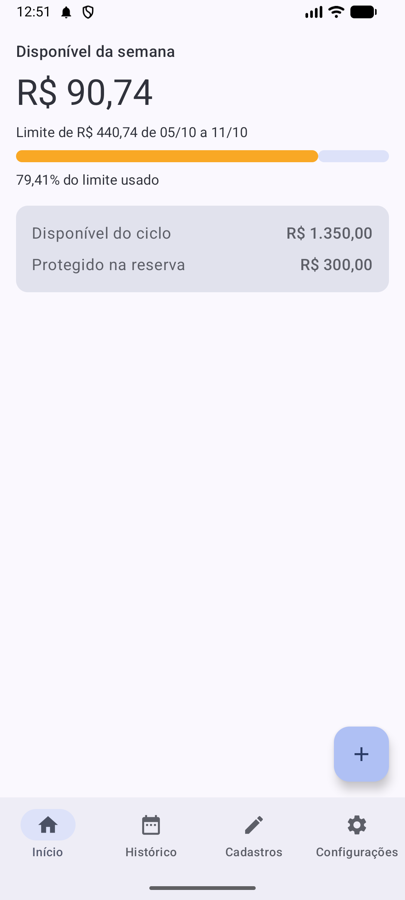
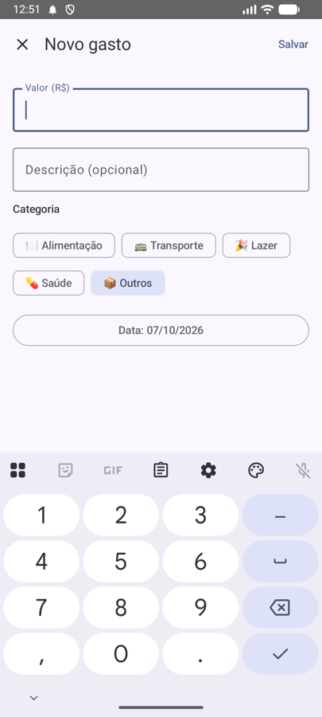
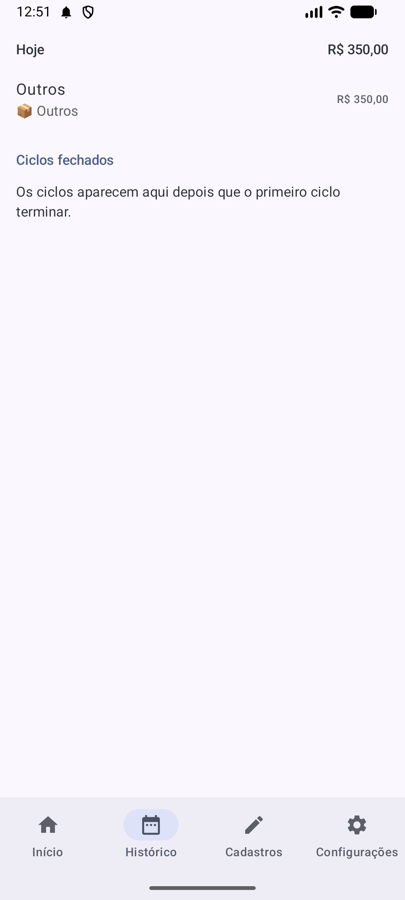
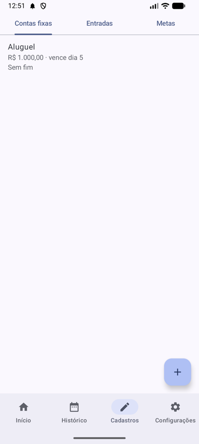

# 💰 Fôlego app


Controle financeiro pessoal que responde, toda semana: **quanto posso gastar sem comprometer as contas fixas e a reserva?**

O Fôlego nasceu como app Android (Kotlin) e agora vive aqui em Python. Já funciona: janela de desktop (tkinter), menu no terminal, regras testadas e dados gravados em disco (`dados/`).

| Início | Novo gasto | Histórico | Cadastros |
| --- | --- | --- | --- |
|  |  |  |  |

*Telas da primeira versão (Android), que servem de referência para a interface.*

## O que o Fôlego calcula
- **Ciclo do salário:** o mês financeiro vai de um pagamento até a véspera do próximo, no dia que você escolher.
- **Reserva antes de tudo:** metas em reais ou em percentual das entradas saem antes de qualquer gasto e nunca aparecem como disponível.
- **Limite da semana:** o que sobra do ciclo é dividido pelos dias que faltam; a barra fica verde, amarela ou vermelha.
- **Contas fixas com parcelas** ("parcela 3 de 10"), entradas recorrentes e avulsas.
- **Alertas** (resumo da semana, 70% e 90% do limite, reserva invadida, fechamento do ciclo), cada um no máximo uma vez por período.
- **Retrato de cada ciclo:** ao fechar, os totais ficam guardados; editar uma conta depois não muda o passado.

A especificação completa (regras RN01 a RN16 e critérios CA01 a CA16) está em [`docs/briefing.md`](docs/briefing.md).

## Núcleo de regras (`src/folego/`)
| Módulo | O que faz |
| --- | --- |
| `modelos.py` | Estruturas de dados: ciclo, entradas, gastos, contas fixas, metas, configurações |
| `calculadora.py` | Ciclo, orçamento, limite semanal, painel e fechamento |
| `decisoes.py` | O que pode ser salvo, bloqueado ou salvo com aviso |
| `alertas.py` | Alertas A1 a A5: quando disparam e o texto de cada um |
| `servicos.py` | Salvar cadastros, configurar e disparar alertas (repositórios são `Protocol`) |
| `formatos.py` | Reais e percentuais no formato brasileiro, sem `float` |
| `armazenamento.py` | `RepositorioJson` (arquivos JSON com escrita segura), trava contra dois Fôlegos abertos e cópias de segurança |
| `exportacao.py` | Exporta um ciclo para CSV (abre no Excel/Numbers) |
| `gui/` | Janela de desktop (tkinter): `app.py`, `contexto.py` e uma aba por arquivo `tela_*.py` |
| `menu.py` | Menu interativo no terminal (primeiro uso, painel, gastos, cadastros com edição, histórico, configurações) |

Dinheiro é sempre em **centavos** (`int`). Os testes em `tests/folego/` são a melhor documentação das regras: o nome de cada teste traz o código da regra (RN) ou do critério (CA).

## Como usar (resumo)
Não precisa instalar nada: o Fôlego só usa o Python que já vem no Mac.

**Janela (recomendado):** dê um duplo clique em `folego.command`, ou no Terminal:
```bash
cd ~/Documents/Projetos/folego-app
python3 -m src.gui
```
Abas: **Início** (quanto pode gastar), **Novo gasto** (registrar, corrigir e excluir), **Histórico**, **Cadastros** (entradas, contas fixas e metas) e **Configurações**.

**Menu de texto (alternativa):** `python3 -m src.main`; digite o número da opção e Enter.

Os dois usam os mesmos dados, em `dados/` (essa pasta não vai para o Git). Só um dos dois pode estar aberto por vez.

## Como rodar (desenvolvimento)
Requer Python 3.10+ (testado também em 3.9).
```bash
git clone https://github.com/Jota0404/folego-app.git
cd folego-app
python -m venv .venv
source .venv/bin/activate      # macOS/Linux  (Windows: .venv\Scripts\activate)
pip install -r requirements.txt
python -m src.main            # abre o Fôlego (dados em dados/; mude com FOLEGO_PASTA)
pytest tests/                  # testes
flake8 src/ tests/             # estilo (config em .flake8)
```

## Seus dados
- Ficam em `dados/` (mude com a variável `FOLEGO_PASTA`): `orcamento.json`, `historico.json` e `configuracoes.json`.
- **Cópias de segurança automáticas:** toda vez que você abre o Fôlego e os dados mudaram desde a última cópia, ele guarda uma em `dados/backups/AAAA-MM-DD-HHMMSS/` (as 10 mais recentes). Para voltar a uma cópia, feche o Fôlego e copie os três arquivos de volta para `dados/`.
- **Um Fôlego por vez:** se abrir um segundo na mesma pasta, ele avisa e sai, para não corromper os dados (no Windows essa trava não existe).
- **Arquivo quebrado:** o Fôlego avisa e não abre, sem sobrescrever nada.

## Atalho para abrir de qualquer pasta
```bash
alias folego='cd ~/Documents/Projetos/folego-app && python3 -m src.gui'
```
Ponha essa linha no `~/.zshrc` e abra um terminal novo.

## Exportar para planilha
No menu, opção **7 - Exportar ciclo (CSV)**. O arquivo vai para `dados/exportacoes/folego-AAAA-MM-DD_a_AAAA-MM-DD.csv`, com entradas, contas fixas, gastos e o resumo do ciclo (separador `;`, valores como `1500,00`).

## Lembrete diário (opcional)
`python -m src.lembrete` roda a rotina de alertas sozinho e manda uma notificação do macOS; se o Fôlego estiver aberto, não faz nada. Para agendar todo dia às 8h, siga [`docs/lembrete-macos.md`](docs/lembrete-macos.md). Nada é instalado sem você pedir.

## Próximos passos
- Visual da janela: hoje usa o tkinter do sistema (Tk 8.5), simples; dá para trocar por `pywebview` sem mexer nas regras.
- Fazer a "hora do resumo" das configurações mudar o horário do lembrete.

## Histórico
[`docs/andamento.md`](docs/andamento.md) e [`docs/qa/`](docs/qa/) registram a construção da versão Android (7 etapas, 05 a 07/10/2026), que foi concluída e depois substituída por esta versão Python (o código Kotlin não está mais em nenhum repositório).
